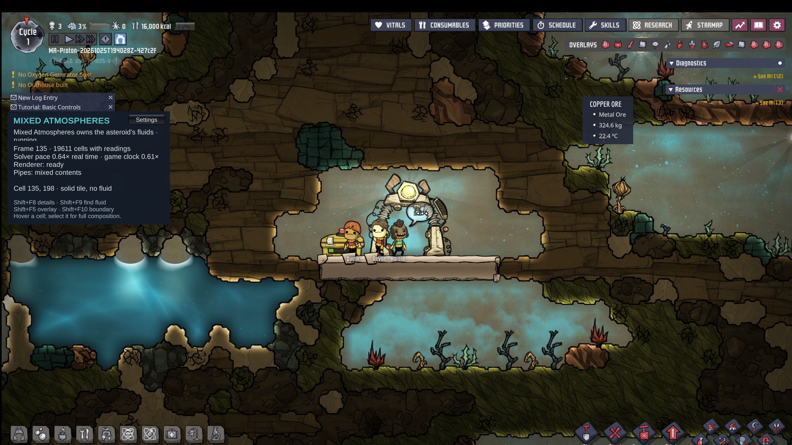
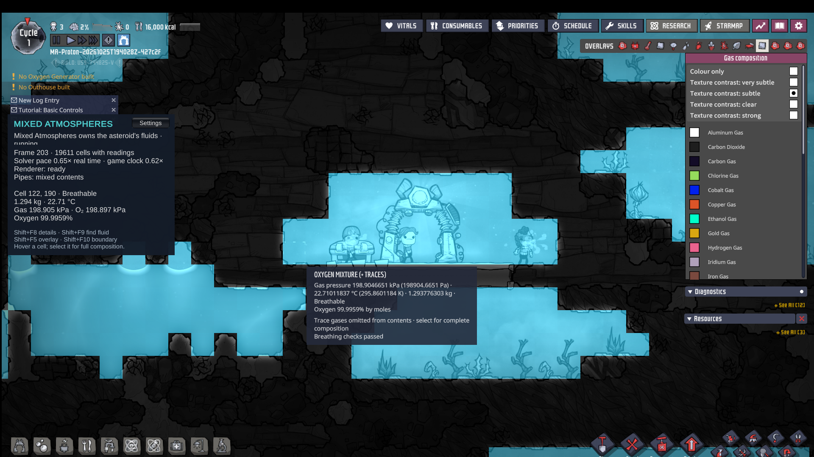
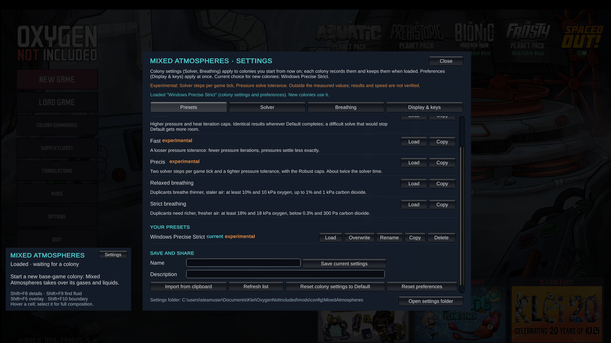
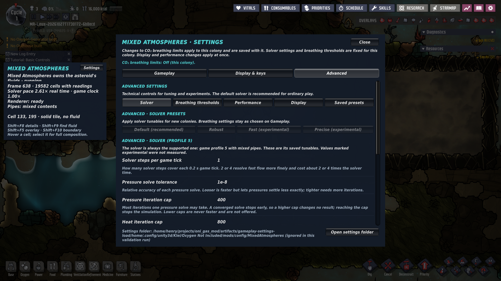

# Mixed Atmospheres

Mixed Atmospheres changes how air, gas, and liquid behave across your asteroid in Oxygen Not Included. Gases now share space and stay mixed, so oxygen, carbon dioxide and other gases travel together. Miscible liquids blend together, while immiscible liquids settle into layers you can see and manage.

Pumps and pipes carry full mixtures. Filters remove the constituent you pick and let the rest pass through. Gas pressure, oxygen partial pressure, and pressure-dependent boiling and latent heat all matter, and the gauges show the mixture you are managing. By default, a room counts as breathable when oxygen is at least 15% by moles and at least 15 kPa of partial pressure. CO₂ breathing limits are off by default; turn them on in Settings → Gameplay to enforce the optional 0.5% and 500 Pa limits.

New colonies keep vanilla generated oxygen and polluted oxygen. Nitrogen content and the nitrogen-air option have been removed. A ten-cycle oxygen shortfall for your starting duplicants is supplied as oxylite beside the printing pod. If a fluid fault occurs, the gas and liquid simulation stops visibly and saves are refused, so reload your last save to continue. The game clock slows to match the solver's pace; this mod does not promise real-time speed.

Plan sustainable oxygen production early. CO₂ still displaces oxygen, so an oxygen-poor room remains unsafe with CO₂ limits off. If you enable the limits, arrange CO₂ removal too. Use the Breathability overlay and partial-pressure readings to check reachable air.

Mixed Atmospheres is a private playtest build for Windows x64 and Linux. It applies to new base-game and Spaced Out! colonies, ONI build 744825, licensed through Steam. Spaced Out! can remain enabled; keep the other gameplay packs disabled for this playtest. Existing vanilla saves keep their vanilla simulation. The Windows build has been tested under Proton; Windows validation is part of your own playtest. Final release-candidate acceptance is still in progress, so this is preparation for private playtesting, not a public release. There is no Workshop release.



*A real development colony in WindowsPlayer under Proton on Linux.*

Settings open from the Mods row or the status panel. **Gameplay** contains the CO₂ breathing limits switch (Off by default), which you can change during play. **Display & keys** contains appearance and shortcuts. **Advanced** contains solver presets, solver controls, breathing thresholds, performance, advanced display and saved presets. Solver controls and numeric thresholds are fixed per colony; preferences apply at once. Files persist in `mods/config/MixedAtmospheres`, outside the mod folder. Older R&D saves, including nitrogen saves and saves using the earlier pressure update, are refused; start a new colony.



*The composition overlay and gas hover in the same development colony.*

Watch [a colony in motion](docs/images/mixed-atmospheres-gameplay.mp4) and [its mixture overlay](docs/images/mixed-atmospheres-composition.mp4).

To install on Windows, extract the private ZIP, close ONI, and run `powershell -NoProfile -ExecutionPolicy Bypass -File .\install_windows.ps1`. Launch ONI through Steam with Spaced Out! enabled. In Mods, enable Mixed Atmospheres and restart. Optionally open Settings, then start a NEW base-game or Spaced Out! colony. The current Spaced Out! build and installation guide are in [docs/spaced-out-private-playtest.md](docs/spaced-out-private-playtest.md).

After playing, please send your Player.log from `%USERPROFILE%\AppData\LocalLow\Klei\Oxygen Not Included\Player.log`.



*Gameplay settings in the actual game; technical controls and presets live under Advanced.*



---

## Technical and reference information

The earlier Linux development README is preserved verbatim below. The current scope, status and Windows installation steps above take precedence.

<details>
<summary>Earlier Linux development reference</summary>

# Mixed Atmospheres for Oxygen Not Included

Mixed Atmospheres replaces Oxygen Not Included's gas and liquid simulation with
its own solver, `MacClosedWorld`. Every cell holds a mixture: gases mix and stay
mixed, miscible liquids mix, pressure is physical, gas expands into vacuum and
boiling depends on pressure. ONI keeps the solids, buildings, duplicants,
critters and plants; every gas and liquid on the asteroid belongs to the mod.

**Status: private base-game playtest build, Linux only.** It is not released
and is not on the Workshop. The scope is the base game on one starting
asteroid ([playtest plan](docs/playtest-plan.md)); Spaced Out!, the gameplay
packs, Windows and real-time speed come later. What works and what is open is
in [implementation status](docs/implementation-status.md).

## Playing

You need your own licensed Linux ONI (build 744825) from Steam, and the build
requirements below.

1. Build and package (adjust the game path to your Steam library):

   ```sh
   export ONI_GAME_DIR="$HOME/.local/share/Steam/steamapps/common/OxygenNotIncluded"
   cmake -S . -B build-production -DCMAKE_BUILD_TYPE=Release -DMA_BUILD_ONI_NATIVE_BACKEND=ON
   cmake --build build-production -j 8
   dotnet build managed/MixedAtmospheres.Oni -c Release -p:OniGameDir="$ONI_GAME_DIR"
   python3 tools/package_probe.py --native build-production/libmixed_atmospheres.so \
     --native-observer build-production/libmixed_atmospheres_oni.so --output artifacts/play
   ```

   Build on the machine that runs the game: host-built libraries need that
   machine's glibc (for other distributions see the
   [Ubuntu 22.04 compatibility build](docs/linux-native-build.md)).

2. Close ONI and copy the whole package into one folder:

   ```sh
   mod="$HOME/.config/unity3d/Klei/Oxygen Not Included/mods/Dev/MixedAtmospheres"
   rm -rf "$mod" && cp -r artifacts/play "$mod"
   ```

   Keep only one installed copy (the static ID is `MixedAtmospheres.IntegrationProbe`).

3. Start ONI through Steam, open **Mods**, enable **Mixed Atmospheres** and
   accept the restart.

4. Start a **new colony** in the base game (Spaced Out! off) on any base-game
   starting asteroid. The mod takes over the asteroid's gases and liquids at the
   first simulation frame; `Player.log` shows `Colony owner started`. Saves of
   that colony load with the mod; ONI without the mod refuses them.

Existing colonies and saves made without the mod keep ONI's own simulation.
Keep a copy of any colony you value.

### What plays differently

- Gases mix and stay mixed, and so do miscible liquids. Carbon dioxide does not
  pool in pits the way it does in vanilla, so scrubbers serve whole rooms.
- Gas compresses and expands into vacuum. Liquid is nearly incompressible:
  there are no 1,000 kg+ compressed liquid cells, and a liquid lock holds only
  the pressure its liquid height supports.
- Boiling depends on pressure, and phase changes take or release latent heat.
- Breathing (easy mode): a cell is breathable with at least 15% oxygen by moles
  and 15 kPa oxygen partial pressure. Optional CO₂ limits default off.
- Pumps and pipes carry full mixtures; filters pass everything except their
  selected constituent.

### Limits

- **Speed:** the solver is slower than vanilla. On a full asteroid the game
  clock slows to the solver's pace (Terra: about 35% of real time on a 12-core,
  24-thread machine;
  see [implementation status](docs/implementation-status.md#base-game-playtest-plan));
  the camera, menus and pause stay responsive.
- **Asteroids:** Terra is the tested asteroid. Rime, Arboria, Aridio, The
  Badlands and Oasisse start and run; on Oceania, Verdante and Volcanea the
  solver can fault in the first seconds.
- If the solver faults, fluids freeze in place, the log names the error and
  saving is refused; reload the last save.

## In the game

A **Mixed Atmospheres** status panel in the main menu and colony shows what the
mod owns, the reading under the mouse (mass, temperature, pressure, oxygen
partial pressure and composition) and any solver error. Open the top-right
**Overlays** menu for **Gas composition**, **Gas pressure**, **Oxygen partial
pressure** and **Breathability**; hover a cell for each non-trace gas and select
it for its full composition.

| Control | Effect |
| --- | --- |
| Shift+F5 | Cycle composition, pressure, oxygen partial pressure, breathability and normal view |
| Shift+F8 | Expand/collapse the status panel |

### Settings

Open **Settings** on Mixed Atmospheres' row in **Mods**, or on the status
panel. **Gameplay** opens first; CO₂ breathing limits default to Off and can
be changed in a running colony. **Advanced → Solver** holds Default, Robust,
Fast and Precise solver presets. **Advanced → Breathing thresholds** holds
oxygen requirements and optional CO₂ thresholds. Solver settings and numeric
thresholds apply to new colonies and are saved per colony. Display, shortcuts
and performance preferences apply immediately. Save and share complete
presets under **Advanced → Saved presets**. Details:
[docs/settings.md](docs/settings.md), [starting air](docs/starting-air.md).

## Build and test

```sh
python3 tools/build.py                       # native + managed suites, no game needed
python3 tools/build.py --native-only --sanitizers --build-dir build-sanitized
./build/ma_demo                              # small gas-mixing demo; ma_demo out.csv writes CSV
./build/ma_demo --benchmark                  # 100,000-cell reference-solver timing
```

`tools/build.py` validates the coverage inventory, runs the Python suite
(`python3 -m unittest discover -s tools/tests`), builds with CMake/Ninja, runs
CTest and then the managed test projects. With `--game-dir` it also compiles the
ONI adapter and runs the tests that need the licensed game declarations.
Sanitizer builds require `--native-only`. Opt-in solver experiments need
`-DMA_BUILD_STAGGERED_EXPERIMENTS=ON`; they are excluded from the default
build, runtime and game DLL. CI is configured for Windows/Linux standalone
builds and Linux sanitizers; an authored workflow is not evidence of a hosted
CI pass.

Release builds enable compiler/linker-checked interprocedural optimization;
`-DMA_ENABLE_IPO=OFF` selects a comparison build. Sanitizer builds disable it.
Current active-cell measurements and outstanding solver blockers are in
[production timestep progress](docs/production-timestep-progress.md).

To inspect your licensed game installation:

```sh
python3 tools/inspect_oni.py --game /path/to/OxygenNotIncluded --dump-api --native-exports
```

In-game validation uses disposable profiles and colonies:
[Linux headless runner](tools/ONI_HEADLESS.md) (`tools/oni_headless.py`),
[Windows validation](docs/windows-validation.md) (`tools/run_colony_validation.ps1`
on Windows and `tools/oni_proton_headless.py` for WindowsPlayer under Proton) and
the [native save/load matrix](docs/native-validation-matrix.md). The colony
owner's checks are `tools/oni_headless.py run --mode colony-owner --scenario NAME`
([scenarios](docs/colony-owner.md#scenarios)). Linux runs
need the private Steam client signed in; there is no bypass. The development
environment and licensed-file locations are described in
[the environment report](tools/ONI_ENVIRONMENT.md).

## How it works

The mod hooks ONI's native simulation (SimDLL) in memory; installed game files
stay intact ([native backend integration](docs/native-backend-integration.md)).
On a new colony one owner takes every gas and liquid cell of the asteroid
([colony owner](docs/colony-owner.md)): ONI's fluid stages are suppressed there,
the owner's solver advances each game frame on its own thread, and its cells are
published back to ONI for rendering, readers, breathing and machines. Element
consumers and emitters, pumps, vents, machines, digging, building, doors, heat
and phase changes all go through the owner as booked transfers, and its mass
and energy ledgers close every frame.

Where to read more:

- [Implementation status](docs/implementation-status.md) and the
  [playtest plan](docs/playtest-plan.md).
- [Solver](native/MAC_SOLVER.md) and the [production kernel](native/MAC_KERNEL.md).
- [Material catalogue](docs/material-catalogue.md),
  [completion plan](docs/completion-plan.md) and
  [ownership coverage inventory](docs/ownership-coverage.md).

## Repository rules

Native code is under `native/`; managed code is under `managed/`. No game
binaries, decompiled game implementations, game-derived contract exports, Steam
credentials or colony saves belong in the source repository or in packages.
Steam license checks are never bypassed. No Workshop item has been published;
public release and Workshop upload require separate authorization.

</details>
