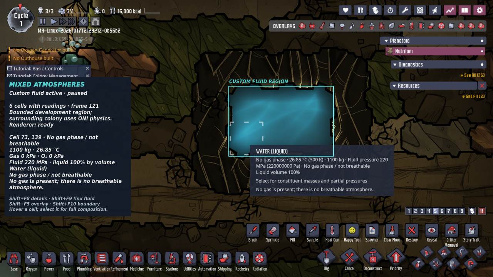

# Mixed Atmospheres for Oxygen Not Included

**Development foundation, not a playable overhaul.** This repository contains a
tested native mixture and fluid engine, a managed API and an explicitly
labelled ONI integration probe. The default probe leaves colony physics
unchanged. The complete gas-and-liquid conversion is not ready for a playtest
or for Workshop publication; see [playtesting readiness](docs/playtesting-readiness.md)
for the open gates and [implementation status](docs/implementation-status.md)
for what exists today.

The target is new colonies in the base game, Spaced Out! and the official
gameplay packs, on Windows and Linux. Every fluid inventory retains the mass of
every constituent. Oxygen, nitrogen, carbon dioxide, temperature, pressure,
buoyancy, phase changes, machines, pipes and metabolism must use the same
conserved state. The accepted scope and milestones are in the
[completion plan](docs/completion-plan.md).

## Seeing the mod in ONI

Every successful load displays a **Mixed Atmospheres** status panel in the main
menu and colony. It identifies native ONI physics, a display fixture or an
active custom fluid region; shows the completed reading frame, renderer state,
mass, temperature, gas pressure, oxygen partial pressure and composition; and
surfaces presentation/domain errors. Liquid readings also show fluid pressure
and liquid volume fraction. Readings follow a mixture cell under the mouse,
otherwise the first supplied cell. Pausing retains the last completed readings.
Returning to the menu retires the colony's readings.

A cyan outline identifies the rectangular region that supplies mixture data.
Normal world rendering uses ONI's gas/liquid shaders with the mixture's colour,
density and phase. Open the top-right **Overlays** menu for **Gas composition**,
**Gas pressure**, **Oxygen partial pressure** and **Breathability**. Hover a cell
for each non-trace gas; select it for full composition, including traces.
Overlays apply only where mixture readings exist. The gas-composition view also
leaves gas-free cells blank; use the panel, hover and normal liquid view to
identify water. Blank areas do not indicate vacuum.

| Control | Effect |
| --- | --- |
| Shift+F5 | Cycle composition, pressure, oxygen partial pressure, breathability and normal view |
| Shift+F8 | Expand/collapse the status panel |
| Shift+F9 | Centre and zoom the camera on the supplied fluid region |
| Shift+F10 | Show/hide the cyan region outline |

An ordinary load reports **native ONI physics**: production whole-colony
ownership is unfinished. To see the custom solver, build the package below and
enable a **disposable visual development colony** before installing:

```sh
python3 tools/configure_visual_demo.py --package artifacts/probe-linux --scene air
```

Use `artifacts/probe-windows` for the Windows package. `--scene water` shows
filled compressed water; `--scene mixed` shows coexisting gas and liquid.
`--scene pillared` and `--scene pillared-water` select a 7×5
[configured room](docs/native-configured-domain.md) with interior solids
(short scenes only). `--long-run` keeps an air, water or mixed scene running for
ten ONI cycles with development telemetry; run the helper with `--help` for
`--frames` and the other options. The helper creates `colony-validation.json`
beside the mod DLL and requires a package built with `--native-observer`. It
leaves colony creation to you and keeps ONI open.

Enable the mod, restart ONI, then manually start a **new disposable colony**
(Terra/Terrania, seed `147147` is the verified development setup). After
selecting the starting duplicants, allow preparation and 120 custom worker
frames to complete. The game pauses for inspection; press **Shift+F9** to find
the chamber. Surrounding colony physics still belongs to ONI. These scenes are
bounded implementation controls, not a playable overhaul.

Use a fresh package or move aside `colony-validation.json` before selecting a
different scene. To return to ordinary observation, remove that configuration
and restart ONI. Keep development scenes and their saves separate from valued
colonies. See [native fluid rendering](docs/native-fluid-rendering.md) for the
rendering contract and in-game checks.



Actual headless Linux ONI: six custom water cells, visible liquid fill, 220 MPa
fluid pressure and 100% liquid volume. The surrounding colony uses native ONI.

## Compile, install and enable

The adapter targets **ONI 744825**, 64-bit Windows and native Linux, including
the base game and Spaced Out!. Its assembly and native fingerprints are checked
at load. A different game update requires a new verified profile; do not bypass
the version check. Use your own licensed Steam installation as the build
reference. Requirements: **Python 3.10+, .NET SDK 10, CMake 3.20+, Ninja and a
C++20 compiler**, plus network access for the native hook dependency on its
first build. Windows requires an **x64 Visual Studio developer shell**.

On Linux, from the repository root (adjust the game path to your Steam library):

```sh
export ONI_GAME_DIR="$HOME/.local/share/Steam/steamapps/common/OxygenNotIncluded"
python3 tools/build.py --game-dir "$ONI_GAME_DIR" --oni-native-observer --build-dir build
python3 tools/package_probe.py --native build/libmixed_atmospheres.so \
  --native-observer build/libmixed_atmospheres_oni.so --output artifacts/probe-linux
```

The build command compiles the native libraries and managed adapter and runs
their checks. On a newer Linux distribution, host-built libraries can require
a newer glibc than the game supports (host builds here need 2.38; the game
needs 2.35). For a portable Linux package, use the
[Ubuntu 22.04 compatibility build](docs/linux-native-build.md) after compiling
the managed adapter, and package its two native libraries and provenance report
as shown there.

On Windows, from an **x64 Visual Studio developer PowerShell** in this repository:

```powershell
$env:ONI_GAME_DIR = 'C:\Program Files (x86)\Steam\steamapps\common\OxygenNotIncluded'
python tools/build.py --game-dir "$env:ONI_GAME_DIR" --oni-native-observer --build-dir build-windows
python tools/package_probe.py --native build-windows/mixed_atmospheres.dll --native-observer build-windows/mixed_atmospheres_oni.dll --output artifacts/probe-windows
```

Package into a **new, empty output directory**. Use `--managed-dir` when the
adapter was built into a custom directory. The package includes the mod DLLs,
platform-native libraries under `native/`, elements and mod metadata;
game-owned DLLs stay in the licensed installation. Two existing MSB3277
HTTP/compression reference warnings are expected (the adapter does not call
those APIs); a successful build has zero errors.

1. Close ONI. Optionally run the visual-demo command above on the packaged folder.
2. Copy the **entire contents** of that package into one folder named
   `MixedAtmospheres` under your ONI **user-data** `mods/Dev` directory:

   | Platform | Destination |
   | --- | --- |
   | Windows | `%USERPROFILE%\Documents\Klei\OxygenNotIncluded\mods\Dev\MixedAtmospheres` |
   | Linux | `~/.config/unity3d/Klei/Oxygen Not Included/mods/Dev/MixedAtmospheres` |

   Windows Documents may be redirected to OneDrive. Follow ONI's actual
   user-data folder in that case. The DLLs and `mod.yaml` must be directly in
   `MixedAtmospheres`, with `native/` beneath it; avoid an extra nested package
   folder. Use the package for the operating system running the game.
   Keep only one installed folder with the mod's `MixedAtmospheres.IntegrationProbe`
   static ID, so an older copy cannot take precedence.
3. Launch ONI through Steam, open **Mods**, enable **Mixed Atmospheres - Integration Probe**, and
   accept its restart. After loading, look for the status panel. For an ordinary
   package it reports native physics; for the visual demo, start a new colony
   as described above.
4. If the panel is missing, check the mod's error in **Mods** and ONI's
   `Player.log`. A successful load also writes `integration-probe.json` beside
   the DLL; native observation writes `native-backend-observation-report.json`.
   A visual scene writes its reports/screenshots under
   `game-contract-local/colony-validation/` in the same mod folder.

For updates, close ONI and replace the installed folder with a fresh package
so stale libraries/configuration cannot survive. Reapply the visual-demo
configuration when desired. Installed SimDLL files are never replaced.

A successful probe does **not** certify authoritative simulation replacement:
`integration-probe.json` retains `AuthoritativeColonySimulationReady: false`, and
the package manifest records `release_ready: false`. If `OnLoad` fails, the
adapter removes its own Harmony patches; the nitrogen elements register only
while the adapter supplies their substance table, so a failed load leaves no
partial state.

## Build and test

```sh
python3 tools/build.py                       # native + managed suites, no game needed
python3 tools/build.py --native-only --sanitizers --build-dir build-sanitized
./build/ma_demo                              # small gas-mixing demo; ma_demo out.csv writes CSV
./build/ma_demo --benchmark                  # 100,000-cell reference-solver timing
```

`tools/build.py` validates the coverage inventory, runs the Python suite
(`python3 -m unittest discover -s tools/tests`), builds with CMake/Ninja, runs
CTest and then the managed test projects. With `--game-dir` it also compiles the
ONI adapter and runs the tests that need the licensed game declarations.
Sanitizer builds require `--native-only`. Opt-in solver experiments need
`-DMA_BUILD_STAGGERED_EXPERIMENTS=ON`; they are excluded from the default
build, runtime and game DLL. CI is configured for Windows/Linux standalone
builds and Linux sanitizers; an authored workflow is not evidence of a hosted
CI pass.

Release builds enable compiler/linker-checked interprocedural optimization;
`-DMA_ENABLE_IPO=OFF` selects a comparison build. Sanitizer builds disable it.
Current active-cell measurements and outstanding solver blockers are in
[production timestep progress](docs/production-timestep-progress.md).

To inspect your licensed game installation:

```sh
python3 tools/inspect_oni.py --game /path/to/OxygenNotIncluded --dump-api --native-exports
```

In-game validation uses disposable profiles and colonies:
[Linux headless runner](tools/ONI_HEADLESS.md) (`tools/oni_headless.py`),
[Windows validation](docs/windows-validation.md) (`tools/run_colony_validation.ps1`
on Windows and `tools/oni_proton_headless.py` for WindowsPlayer under Proton) and
the [native save/load matrix](docs/native-validation-matrix.md). Linux runs
need the private Steam client signed in; there is no bypass. The development
environment and licensed-file locations are described in
[the environment report](tools/ONI_ENVIRONMENT.md).

## How it works

The production architecture uses **native SimDLL hooks** to put the custom
fluid engine inside ONI's simulation schedule
([native backend integration](docs/native-backend-integration.md)). The custom
engine owns fluid inventories and physics; verified native services keep solids
and buildings. Native scalar fluid cells become compatibility projections, while
machines, heat, callbacks, rendering and saves use one completed physical frame.
The mod loads its own libraries and changes verified code in memory; installed
game files remain intact.

The production colony solver is `MacClosedWorld` (`native/src/mac_*.cpp`); ONI's
native fluid simulation is what the mod replaces and is not used as the solver.
Today it runs inside a bounded [sealed native domain](docs/sealed-native-domain.md):
one development room, five species, with transfers, breathing and pressure
readers, heat, conduction, gravity and paired colony saves verified in real
Linux and Windows games. Whole-colony ownership, a production-accurate timestep,
machines and complete persistence remain open.

Where to read more:

- [Implementation status](docs/implementation-status.md): every area, its
  verified scope and its owning document.
- [Playtesting readiness](docs/playtesting-readiness.md): the five playtest
  gates, open decisions and work plan.
- [Completion plan](docs/completion-plan.md): accepted target, milestones and
  release gates.
- [Physics and integration contract](docs/architecture.md),
  [inspected native boundary](docs/interop-contract.md) and
  [ownership coverage inventory](docs/ownership-coverage.md).
- [Mixture presentation](docs/mixture-presentation.md) and the
  [Steam Community concept draft](docs/steam-community-draft.bbcode).

## Repository rules

Native code is under `native/`; managed code is under `managed/`. No game
binaries, decompiled game implementations, game-derived contract exports, Steam
credentials or colony saves belong in the source repository or in packages.
Steam license checks are never bypassed. No Workshop item has been published;
public release and Workshop upload require separate authorization.
