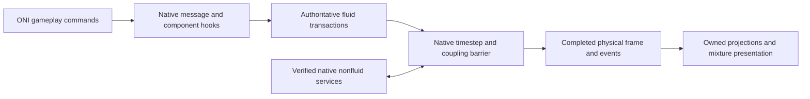

# Native simulation backend integration

Accepted architecture, 2026-10-16: the custom native engine owns all fluid
physics inside ONI's own simulation schedule, reached through hooks in the
game's native SimDLL, while ONI keeps its verified nonfluid services. On
2026-10-18 the user decided that `MacClosedWorld` (`native/src/mac_*.cpp`) is the
production colony fluid solver. ONI's native SimDLL fluid simulation is what
the mod replaces; it must not be used as the solver. The delivery target is the
full [completion plan](completion-plan.md): new colonies, Windows x64, native
Linux x86-64, the base game, Spaced Out! and all supported gameplay packs.

**Current status.** Playable whole-colony takeover is not implemented. Two
parts exist:

- An opt-in forwarding **observer** (observer ABI 4) that installs the hooks and
  preserves native physics. It is observation only.
- The **sealed native domain**: development rooms where `MacClosedWorld` owns
  every fluid cell on the native worker timestep while the rest of the colony
  stays native. Its hub is [sealed native domain](sealed-native-domain.md); the
  larger room with interior solids is the [configured domain](native-configured-domain.md).

The domain's feature contracts and their verification are in:

| Document | Contents |
| --- | --- |
| [Boundary transactions](native-domain-transactions.md) | Cell-mass edits, radius and rectangular consumption, the accepted frame-input journal and completed image, live duplicant breathing |
| [Readers](native-domain-readers.md) | Physical pressure, breathing selection, restored-reader checks, GPU texture readback |
| [Completed native exports](native-domain-publication.md) | Actual game-buffer source binding, immutable bounded-domain leases and matching solid heat journals |
| [Physics](native-domain-physics.md) | Scenarios 0–7, filled-liquid gravity, gas/liquid cells, mixed conduction, viscosity, initial inventory, object and solid-cell heat |
| [Persistence](native-domain-persistence.md) | Durable actors, in-flight CO2, natural day autosaves, same-process reload, orbital references, Spaced Out saves |
| [Platform and numerics](native-platform-numerics.md) | Linux trampoline storage, solver arithmetic scope, binary32 wire values |
| [Validation matrix](native-validation-matrix.md) | Matrix runner, platform terms, fluid regression and WindowsPlayer feature matrices |
| [Actor checkpoint format](../native/ONI_ACTOR_CHECKPOINT.md) | `MAACTR01` bytes |
| [Physical checkpoint format](../native/MAC_CHECKPOINT.md) | `MACCLS01` bytes and paired capture |

## Supported build and installation

Profiles target ONI **744825**, Steam BuildID **24423041**, Unity
**6000.3.5f2**. Valve's public branch metadata (checked anonymously through
SteamCMD on 2026-10-17) and Klei's
[release index](https://kleiforums.com/game-updates/oni-alpha/) (checked
2026-10-16; [release notes](https://kleiforums.com/game-updates/oni-alpha/744825-r2776/))
list this as the latest public build. Any other build needs inspection and new
profiles.

| Platform | Native image | SHA256 |
| --- | --- | --- |
| Windows x64 | `Plugins/x86_64/SimDLL.dll` | `031960f120ac1d59fd8e43f6e1a7369111c629b90c24d52186b691dfe2d8a727` |
| Linux x86-64 | `Plugins/libSimDLL.so` | `85111cd0b1fc14c79c785581d6c055280b9d48ba705776f3d14eb0a7b239c12d` |

The mod loads its own library from `native/<platform>` and patches verified
entry points in the loaded game module; installed game files stay intact.
Profiles (`docs/native-hook-profiles.json`) bind the native and Assembly-CSharp
hashes. Windows locations come from the matching shipped PDB and Linux
locations from its dynamic symbols; function fingerprints verify loaded code
before any hook is installed. Each OS has its own calling-convention and
private-layout evidence: never reuse Windows C++ layouts on Linux. No PDB or
game binary is distributed. Unknown binaries and conflicting entry-point hooks
reject activation.

Detours use pinned Funchook 1.1.3 and diStorm sources
([upstream](https://github.com/kubo/funchook)), with archive hashes and license
notices. Source-hash-checked patches add short JMP/Jcc relocation for Linux's
batch-message prologue (internal branches, LOOP instructions and several
relative operands in the overwritten region reject preparation), replace
unaligned code-operand accesses with `memcpy`, and make diStorm's high-bit
instruction flag unsigned. Synthetic code tests cover branch outcomes,
forwarding, byte restoration and rejection, including a widened prologue that
cannot fit the trampoline buffer. The dependency C sources are part of the
sanitizer build. Linux trampolines live in verified executable-page padding;
see [trampoline storage](native-platform-numerics.md#linux-trampoline-storage).

The inspected Linux UnityPlayer requires glibc 2.35, so release libraries must
be built against that baseline and checked for newer symbol requirements. Host
builds need 2.38 and do not establish release compatibility. The
[Ubuntu 22.04 builder](linux-native-build.md) produces libraries that need at
most glibc 2.34; game and release acceptance of them remain separate.

### DLC content preflight

Matching game builds also need matching DLC. Before entering the backend scene,
the headless load driver reads the selected save's content metadata and checks
the game's normal subscription, installation and enabled-content result. It
records required, active and unavailable IDs and rejects a mismatch without
initializing the native simulator. It never enables missing assets or alters
entitlement checks. Without this check, a Spaced Out save loaded on a Linux
installation lacking `expansion1_bundle` failed on unknown native element
`134298891` (Uranium Ore) and then in ONI's world-generation fallback; it now
rejects at the main menu with `EXPANSION1_ID` unavailable. Loading with the
bundles is covered in [Spaced Out saves](native-domain-persistence.md#spaced-out-saves).

## Ownership and data flow



| State or service | Required owner |
| --- | --- |
| Constituent mass, internal energy, momentum, geometry | Custom native engine |
| Pipes, storage, bottles, suits, particles, machine fluid inventories | Custom transactions and persistence |
| Native scalar fluid cells and dominant element | Compatibility projection only |
| Solid-only mechanics, buildings, chunks, backwalls | Original services where independently verified |
| Fluid/nonfluid heat, displacement, melting, support, pressure damage | Explicit coupled adapter with one conserved transfer |
| Fluid disease, radiation, light absorption | Mixture-aware services; passive metadata is insufficient |
| Snapshots, rendering, sensors, navigation, callbacks | One completed-frame projection with explicit lifetimes |

Native projections may hold gas/liquid identities and bulk readings but must
never reconstruct composition, pressure or internal energy. Every native fluid
reader and writer must be routed or replaced, including pressure and liquid
flow, thermal exchange, interactions, load-time and runtime transitions,
sublimation, emitters and consumers. Where fluid work is inlined, replace the
containing phase or task. Keep original nonfluid behaviour only after proving
its ownership.

Vacuum-shadow import and definition filtering are historical controls, not the
production architecture; their zero-native-fluid assertions do not prove hook
ownership. Execution traces, writer coverage and conservation must show that
only the custom engine changes authoritative fluids.

## Frames, callbacks and failures

The observed Linux path is `Sim::Main` -> `SimBase::Step`, using
`SimFrameManager::ProcessNextFrame` and `SimBase::UpdateData`. Equivalent
Windows order and exact worker completion barriers must be established by
instrumentation; exported names alone do not prove phase coverage. Linux's
outer `Step` also runs synchronization-only passes, so its entry count is not
elapsed time: count positive `ProcessNextFrame` returns and `UpdateData` calls.

Advance once per actual native timestep, normally 0.2 seconds, not once per
asteroid record or snapshot request, and keep the order of queued timesteps.
Tickets carry a session identity and monotonic sequence; `numFramesProcessed`
is not a unique frame identity. Worker hooks never call Unity or managed
gameplay.

Reserve mass, output capacity, power and heat before side effects. Publish
immutable completed snapshots and event outboxes together. Preserve native
handles, retained callbacks and exactly-once delivery. Mod-owned buffers live
until every consumer releases its lease; original native pointers are never
repurposed as mixture storage.

Retry custom candidates before irreversible native work. A later failure
faults the session, freezes advancement, refuses saves and requires a
checkpoint reload; do not claim native rollback without a tested restoration
protocol. Exceptions cannot unwind through callbacks. Install and remove hooks
only while simulation workers are stopped; modules and trampolines stay
resident while callers can reference them.

## Interfaces and saves

The C ABI is versioned (`ma_oni_*`), with explicit sizes and buffer ownership;
every size and version field must match exactly, and native and managed clients
are rebuilt together.

**Observer** (`native/include/mixed_atmospheres/oni_backend.h`): inspection,
attachment, counters, a 4,096-event control trace and detachment. Observer
ABI 4 has 29 hook slots and a 528-byte status; older libraries reject before the
different status layout is read. Windows has 25 profiled locations and Linux
29: `Step`, the two gas-interaction entries and the secondary-base emitter
dispatch are Linux-only. ABI 4 added the element-chunk heat contact
([object heat](native-domain-physics.md#native-object-heat)). Attachment
requires null `gSim`/`gSimData` and verifies every fingerprint before preparing
any detour; detachment refuses a live simulator or executing hooks. Traces
record control flow only and truncate at capacity rather than overwrite.

**Development domain** (`oni_domain.h`, domain ABI 2): a 40-byte
configuration, 440-byte status and 96-byte five-species cell reading, with
explicit start/copy/stop and material queries. Activation checks the exact
profile and the padded native grid on both platforms. There is no independent
managed advance and no second clock. Domain ABI 1's four-species layout is
historical. Additive capabilities each report their own version:

| Capability (`ma_oni_domain_*`) | Version | Contract |
| --- | --- | --- |
| `heat`, `transfer`, `actor`, `thermal`, `gravity` | 1, 2, 1, 2, 1 | [Sealed domain](sealed-native-domain.md) |
| `radial_consumption`, `rectangular_consumption` | 1, 1 | [Transactions](native-domain-transactions.md) |
| `frame_inputs`, `completed_snapshot` | 1, 1 | [Transactions](native-domain-transactions.md#accepted-frame-inputs-and-completed-images) |
| `initial_inventory`, `viscosity`, `chunk_heat`, `solid_heat` | 1, 1, 1, 1 | [Physics](native-domain-physics.md) |
| `configured` | 1 | [Configured domain](native-configured-domain.md) |
| `checkpoint`, `pair` | 1, 1 | [Physical checkpoints](../native/MAC_CHECKPOINT.md) |
| `actor_checkpoint` | 1 | [Actor checkpoint](../native/ONI_ACTOR_CHECKPOINT.md) |

Production session initialization, commands, immutable physical-frame leases,
checkpoints and shutdown follow separate gates.

**Saves.** Only new colonies opt into mixture ownership; headless
world-generation settling and vanilla saves keep the original simulator. Stage
all generated worlds and validate compressed-liquid/EOS support before
activation; never clamp mass, insert seed gas or sanitize through the old
vacuum-shadow importer. Save native nonfluids, physical fluids, containers,
transport queues, processes, settings and material versions at one completed
frame. Manual saves, autosaves, previews, resume and cross-platform transfer use
one atomic versioned outer container. Test stock-loader rejection before world
mutation. A load without the mod must never turn scalar projections into a
playable mixture save. The existing envelope/codec helpers do not satisfy
integrated persistence.

## Build and observe

The default build and probe do not enable native hooks. Build the optional
observer and standalone controls, then run the isolated licensed-game host
(licensed files stay outside the repository):

```sh
python3 tools/build.py --native-only --oni-native-observer --build-dir build-oni-observer
dotnet build tools/NativeShadowProbe -c Release
python3 tools/NativeHookProbe/run.py \
  --game /path/to/OxygenNotIncluded \
  --observer build-oni-observer/libmixed_atmospheres_oni.so \
  --contract /private/game-contract-local \
  --output artifacts/native-hooks-linux
```

On Windows use an x64 Visual Studio developer environment and
`build-oni-observer/Release/mixed_atmospheres_oni.dll` (single-configuration
generators omit `Release/`); the same Python runner works. It compares separate
unhooked and observed processes for six cases (baseline flow, two active
regions, melting, filtered transitions, native load and registered fluid
actors), plus an optional native-body case. Cases, Wine options and pass
criteria are in [the forwarding probe](../tools/NativeHookProbe/README.md).

To inspect or reproduce the profiles:

```sh
python3 tools/oni_hook_profiles.py validate
python3 tools/oni_hook_profiles.py inspect \
  --windows-game /private/windows-game --linux-game /private/linux-game \
  --output /private/candidate-profiles.json
```

For Linux Unity observation, build the ONI adapter, package it with the
observer and use the forwarding mode:

```sh
dotnet build managed/MixedAtmospheres.Oni -c Release -p:OniGameDir=/path/to/OxygenNotIncluded
python3 tools/package_probe.py --native build/libmixed_atmospheres.so \
  --native-observer build-oni-observer/libmixed_atmospheres_oni.so \
  --output artifacts/native-observer-package
python3 tools/oni_headless.py run --package artifacts/native-observer-package \
  --mode native-observer --frames 10 --timeout 600
```

For Windows Unity, build the adapter against the Windows installation, package
the Windows core DLL with the observer DLL, and run the disposable-colony
wrapper with the observer switch:

```powershell
./tools/run_colony_validation.ps1 -Package artifacts/native-observer-package `
  -Output local/colony-runs/native-observer-windows `
  -NativeObserver -Frames 10 -TimeoutSeconds 900
```

WindowsPlayer can also run from Linux through the
[Proton runner](windows-validation.md#windowsplayer-under-proton), which records
Proton execution separately from the Windows OS.

Packaging takes dependency notices and sources from exactly one complete CMake
build root (including Visual Studio's `Release/`) and ships the licenses, the
modified dependency source archive and exact patch/build instructions. It
writes an explicit `native-backend-observation.json` opt-in; the mod writes
`native-backend-observation-report.json`, which both wrappers require along
with native progress and byte-identical snapshots. Other validation modes
refuse packages with native hooks. The native library stays resident, and a
failed-load restoration failure requests process exit. `native-observer` mode
does no custom material import; the stricter `snapshot-copy` staging gate still
rejects unsupported compressed liquids.

MinGW Windows builds of the observer also link pinned mimalloc (its C++
allocations) and ARM optimized-routines `exp`/`log` in place of MinGW's heap
and x87 functions, which doubled the game kernel's frame time; their licenses
ship in the package. Linux keeps glibc. Each platform is deterministic, but
their math libraries differ in the last bit, so a save continues with its own
platform's arithmetic.

## Current evidence and limits

Observer forwarding, as of 2026-10-17:

- **Native suites.** All backend CTests pass in Linux Release and under
  ASan/UBSan with the solver and Funchook/diStorm C sources instrumented (the
  game is not instrumented), as Windows binaries under Wine, and with MSVC on
  Windows (strict warnings, ABI/hash/lifecycle and short-branch relocation
  controls).
- **Isolated licensed SimDLL.** With observer ABI 4, the Linux library and the
  Windows binaries under Wine pass all six unhooked/observed comparisons and the
  native-body case, with identical physical, event, save and actor reports:
  twelve positive timestep returns and physical updates per case, thirteen in
  the actor case. MSVC binaries on Windows passed the six comparisons with an
  earlier observer ABI. On Linux the emitter runs only through the GCC
  secondary-base dispatch, counted with the canonical entry. The actor case
  shows that native `Modify` resets the emitter interval clock and that emitted
  mass is a handle-indexed status table with zero-mass placeholders, not an
  event stream.
- **Unity colonies.** Linux and actual Windows Unity colonies forward with
  original ONI owning physics: ten native timestep returns and physical
  updates, byte-identical snapshots and all 47 channels (the Windows colony with
  nine worlds and three duplicants, its profile restored byte for byte). The
  Windows forwarding run used observer ABI 1; current hooks run in actual
  Windows and Linux colonies through the native-domain controls. A validator
  must wait for native timestep counters: managed acknowledgments are not
  physical progress.

These results grant no mixture ownership, rendering, takeover or performance
claim. The trace holds 4,096 events and full Unity traces fill it during world
generation, so a trace prefix is not complete phase coverage. Emitter
blocked/unblocked callbacks, multiple handles and every inlined or virtual
dispatch path still need dedicated forwarding controls. The two Linux
gas-interaction hooks have never been exercised. Inspection of the pinned
images finds no simulation caller of those exports and no Windows procedure
or inline site for their names; see [Windows gas ownership](windows-gas-ownership.md)
for the actual pressure/displacement/postprocess boundaries. Exported symbols
and successful installation do not prove writer coverage.

Sealed-domain Unity evidence (mixed air, compressed water, heat commands, point
sources, registered actors, conduction, gravity, paired capture, checkpoint
continuation and colony save/load) is in
[the sealed-domain record](sealed-native-domain.md#current-evidence), including
the padded-index fix for native cell indices. Feature evidence is in the
documents listed at the top.

## Implementation gates

1. **Native observer:** reproducible profiles, ABI/code verification,
   forwarding hooks, original-behaviour comparisons, isolated Windows/Linux
   runs.
2. **Controlled takeover:** custom mixtures in a bounded Unity colony with
   progressing native solids/buildings, balanced events, multiworld scheduling,
   writer coverage and safe teardown on both platforms.
3. **Production physics:** repair strong-flow/range failures; complete vacuum,
   free surfaces, immiscible geometry, phase change,
   compressed liquids and performance without relaxing scientific gates.
4. **Complete gameplay:** every inventoried producer/consumer and inventory;
   power, enthalpy, chemistry and metabolism; nitrogen starts, life support,
   research, UI and endgame progression.
5. **Persistence/release:** integrated saves, all 32 DLC configurations on both
   OSes, ten-cycle playable acceptance, 100-cycle regressions, 1,000-cycle
   all-content runs and reproducible mod-owned packages.

Keep 10,000-step mass/energy drift bounds of 1e-8/1e-6, separate trace/source
ledgers, and 25 ms per 0.1 simulated seconds for 100,000 active cells on a
Ryzen 5900X. Report hook/publication overhead, game p50/p95 times and peak
memory. Sustained 1x must have no growing queues or retained history. Observer
success, unit tests and presentation fixtures do not complete takeover or
release.
