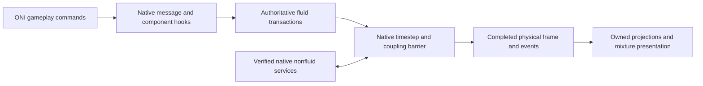

# Native simulation backend integration

Accepted architecture, 2026-10-16. Direct native integration is a core part of
the complete Mixed Atmospheres overhaul. The custom native engine must own all
fluid physics inside ONI's simulation schedule; ONI retains verified nonfluid
services. The delivery target remains the full [completion plan](completion-plan.md):
new colonies, Windows x64, native Linux x86-64, base game, Spaced Out! and all
supported gameplay packs.

**Current status:** playable whole-colony takeover is not implemented. The
opt-in forwarding observer preserves native physics. A separate
[sealed native domain](sealed-native-domain.md) now connects the closed MAC
solver to the native worker timestep in a six-cell development room. Its
Linux controls cover mixed air, filled liquid, point transfers, registered
development actors, heat, conduction, gravity and paired colony persistence.
Saved domains resume with exact physical continuation, including a two-session
main-menu reload in one Unity process. The native/public padded-index mismatch
that caused earlier gas failures is fixed. Surrounding colony physics,
production actors and persistent live actors remain outside this experiment.

## Supported build and installation

Initial profiles target ONI **744825**, Steam BuildID **24423041**, Unity
**6000.3.5f2**. Klei lists 744825 as the latest public release when checked on
2026-10-16. Future builds require inspection and new profiles.
[Klei release index](https://kleiforums.com/game-updates/oni-alpha/) and
[release notes](https://kleiforums.com/game-updates/oni-alpha/744825-r2776/).

| Platform | Native image | SHA256 |
| --- | --- | --- |
| Windows x64 | `Plugins/x86_64/SimDLL.dll` | `031960f120ac1d59fd8e43f6e1a7369111c629b90c24d52186b691dfe2d8a727` |
| Linux x86-64 | `Plugins/libSimDLL.so` | `85111cd0b1fc14c79c785581d6c055280b9d48ba705776f3d14eb0a7b239c12d` |

The mod loads its own library from `native/<platform>` and modifies verified
entry points in the loaded game module. Installed game files remain intact.
Pinned Funchook 1.1.3 and diStorm sources provide detours, with archive hashes
and license notices retained. [Upstream documentation](https://github.com/kubo/funchook).
The build applies a source-hash-checked short-JMP/Jcc relocation extension for
Linux's batch-message prologue. Internal branches, LOOP instructions and multiple
relative operands in the overwritten region reject preparation. Synthetic code
tests exercise branch outcomes, forwarding, byte restoration and rejection,
including a widened prologue that cannot fit the trampoline buffer.
Source-hash-checked patches also replace unaligned code-operand accesses in
Funchook/diStorm with `memcpy` and make diStorm's high-bit instruction flag
unsigned. Dependency C sources are included in the sanitizer build.
The Linux backend now uses [verified executable-page padding for all 28
trampolines](native-trampoline-storage.md). It validates the loaded segment
boundaries, original zero bytes, bounded capacity and private RX permissions.
Cleanup restores the original bytes and RX permissions without unmapping the
game image. Synthetic controls deny nearby allocation, run 96 complete hook
cycles, exhaust a bounded buffer and inject a cleanup permission failure.
For unregistered Funchook users, the allocation patch still scans nearby gaps
and claims pages with `MAP_FIXED_NOREPLACE`; it never overwrites occupied
mappings or accepts a relocated address. Controls retain ignored-hint and
concurrent-claim coverage. Both patches and pinned archives ship in the package.

During the colony save/load work, private Linux runs
`20261017T000353Z-2e92d9` and `20261017T000743Z-dcba26` fail during hook-0 near-page
allocation before colony activation; these remain failures. The latter already
uses the initial allocation repair, so the exact address-layout cause is not
established by the synthetic controls. The following diagnostic build passes
real Unity initialization in `20261017T000916Z-64e170`. This is startup evidence,
independent of the unfinished colony save/load check.

Profiles bind native and Assembly-CSharp hashes. Windows locations come from
the matching shipped PDB; Linux locations come from its dynamic symbols.
Function fingerprints verify loaded code before hook installation. Each OS has
its own calling-convention and private-layout evidence: do not reuse Windows
C++ layouts on Linux. No PDB or game binary is distributed. Unknown binaries
and conflicting entry-point hooks reject activation.

The inspected Linux UnityPlayer requires glibc 2.35. Release libraries must be
built against that baseline and checked for newer symbol requirements. Current
host builds do not establish release compatibility.
The [Ubuntu 22.04 native builder](linux-native-build.md) now supplies a frozen
baseline build with all 13 native tests and 89 managed/native ABI checks
passing. Both libraries require at most glibc 2.34. Its checked source/binary
record can be included in probe packages; game/release acceptance remains separate.

## Ownership and data flow



| State or service | Required owner |
| --- | --- |
| Constituent mass, internal energy, momentum, geometry, dissolved gases | Custom native engine |
| Pipes, storage, bottles, suits, particles, machine fluid inventories | Custom transactions and persistence |
| Native scalar fluid cells and dominant element | Compatibility projection only |
| Solid-only mechanics, buildings, chunks, backwalls | Original services where independently verified |
| Fluid/nonfluid heat, displacement, melting, support, pressure damage | Explicit coupled adapter with one conserved transfer |
| Fluid disease, radiation, light absorption | Mixture-aware services; passive metadata is insufficient |
| Snapshots, rendering, sensors, navigation, callbacks | One completed-frame projection with explicit lifetimes |

Native projections may contain gas/liquid identities and bulk readings. They
must never reconstruct composition, pressure or internal energy. Route or
replace every native fluid reader/writer, including pressure/liquid flow,
thermal exchange, interactions, load-time/runtime transitions, sublimation,
emitters and consumers. Replace the containing phase/task where fluid work is
inlined. Preserve original nonfluid behavior only after proving its ownership.

Vacuum-shadow import and definition filtering remain historical controls, not
the production architecture. Their zero-native-fluid assertions do not prove
native-hook ownership. Execution traces, writer coverage and conservation must
show that only the custom engine changes authoritative fluids.

## Frames, callbacks and failures

The observed Linux path is `Sim::Main` -> `SimBase::Step`, using
`SimFrameManager::ProcessNextFrame` and `SimBase::UpdateData`. Instrumentation
must establish equivalent Windows order and exact worker completion barriers.
Exported names alone do not prove phase coverage.

Advance once per actual native timestep, normally 0.2 seconds, not once per
asteroid record or snapshot request. Preserve ordering for queued timesteps.
Tickets contain session identity and monotonic sequence; `numFramesProcessed`
is not a unique frame identity. Worker hooks never call Unity/managed gameplay.

Reserve mass, output capacity, power and heat before side effects. Publish
immutable completed snapshots and event outboxes together. Preserve native
handles, retained callbacks and exactly-once delivery. Mod-owned buffers live
until all consumers release their leases; original native pointers are not
repurposed as mixture storage.

Retry custom candidates before irreversible native work. A subsequent failure
faults the session, freezes advancement, refuses saves and requires checkpoint
reload. Do not claim native rollback without a tested restoration protocol.
Exceptions cannot unwind through callbacks. Install/remove hooks only while
simulation workers are stopped; modules and trampolines stay resident while
callers can reference them.

## Interfaces and saves

Expose a versioned `ma_oni_*` C ABI with explicit sizes and buffer ownership.
The observer surface is inspection, attachment, counters and detachment.
Observer ABI 3 has 28 hook slots and a 512-byte status; older libraries reject
before their different status layout is read. Two gas interaction slots are
Linux-only; Windows has 24 concrete locations and Linux has 28. Windows's
`Step`, gas interaction functions and Linux secondary-base emitter dispatch
have no standalone profiled locations.
The separate development-domain ABI 2 has 40-byte configuration, 440-byte
status and 96-byte five-species cell readings, with explicit start/copy/stop and material
queries. Activation checks the exact profile and padded-grid dimensions on both
platforms. Production session initialization, commands, immutable
physical-frame leases, checkpoints and shutdown follow separate gates. There
is no independent managed advance creating a second clock. Domain ABI 1's
four-species layout is historical. Rebuild native/managed clients together;
exact ABI checks reject older binaries before copying.

Only new colonies opt into mixture ownership. Headless world-generation
settling and vanilla saves retain the original simulator. Stage all generated
worlds and validate compressed-liquid/EOS support before activation; do not
clamp mass, insert seed gas or sanitize through the old vacuum-shadow importer.

Save native nonfluids, physical fluids, containers, transport queues, processes,
settings and material versions at one completed frame. Manual/autosave, preview,
resume and cross-platform transfer use one atomic versioned outer container.
Test stock-loader rejection before world mutation. Missing-mod loads must never
turn scalar projections into playable mixture saves. Existing envelope/codec
helpers do not satisfy integrated persistence.

## Build and observe

The default build and probe do not enable native hooks. Build the optional
observer and standalone controls, then build the isolated licensed-game host:

```sh
python3 tools/build.py --native-only --oni-native-observer --build-dir build-oni-observer
dotnet build tools/NativeShadowProbe -c Release
python3 tools/NativeHookProbe/run.py \
  --game /path/to/OxygenNotIncluded \
  --observer build-oni-observer/libmixed_atmospheres_oni.so \
  --contract /private/game-contract-local \
  --output artifacts/native-hooks-linux
```

On Windows use an x64 Visual Studio developer environment and
`build-oni-observer/Release/mixed_atmospheres_oni.dll` for the Visual Studio
multi-configuration generator (single-configuration generators omit `Release/`).
The same Python runner supports
Windows. It compares separate unhooked/observed processes for baseline flow,
two active regions, melting, filtered transitions and native load controls.
Each process has a 45-second limit. It compares physical/event/save reports,
checks hook entry/exit balance and trace nesting, rejects live detachment and
tests undersized output buffers. The two-region fixture heats a pair of solids
in each half and requires twelve timesteps, rather than twenty-four.

To inspect or reproduce the original profiles (licensed files stay external):

```sh
python3 tools/oni_hook_profiles.py validate
python3 tools/oni_hook_profiles.py inspect \
  --windows-game /private/windows-game --linux-game /private/linux-game \
  --output /private/candidate-profiles.json
```

For actual Linux Unity observation, compile the normal ONI adapter, package
with the extra observer and use its separate forwarding test mode:

```sh
dotnet build managed/MixedAtmospheres.Oni -c Release -p:OniGameDir=/path/to/OxygenNotIncluded
python3 tools/package_probe.py --native build/libmixed_atmospheres.so \
  --native-observer build-oni-observer/libmixed_atmospheres_oni.so \
  --output artifacts/native-observer-package
python3 tools/oni_headless.py run --package artifacts/native-observer-package \
  --mode native-observer --frames 10 --timeout 600
```

For actual Windows Unity observation, build the ONI adapter against the Windows
installation and package the Windows core DLL with the observer DLL above. Then
run the disposable-colony wrapper with the explicit observer switch:

```powershell
./tools/run_colony_validation.ps1 -Package artifacts/native-observer-package `
  -Output local/colony-runs/native-observer-windows `
  -NativeObserver -Frames 10 -TimeoutSeconds 900
```

The wrapper checks the package's observer opt-in, native progress and ownership
report, and byte-identical snapshots. Other validation modes refuse packages
with native hooks. Packaging locates dependency notices and sources in exactly
one complete CMake build root, including Visual Studio's `Release/` layout.

Packaging includes the dependency licenses, modified dependency source archive
and exact patch/build instructions. It creates an explicit
`native-backend-observation.json` opt-in. The mod writes
`native-backend-observation-report.json`; the headless runner requires that
report in addition to normal startup/colony evidence. The native library stays
resident; failed-load restoration failures request process exit. `native-observer`
mode validates forwarding and byte-identical native snapshots without attempting
custom material import. The stricter `snapshot-copy` staging/roundtrip gate is
unchanged and still rejects unsupported compressed liquids.

## Current evidence and limits

Verified on 2026-10-16:

| Control | Result and limit |
| --- | --- |
| Linux Release | All ten default native CTests pass with the observer enabled, including ABI, relocation and sealed-domain controls. Full managed/game-declaration regressions also pass. |
| Linux ASan/UBSan | All ten native CTests pass with the solver and Funchook/diStorm C sources instrumented. The licensed game itself is not sanitizer-instrumented. |
| Isolated licensed Linux | Five unhooked/observed comparisons pass, including populated/empty batches and two active regions. Physics, event and native-save reports match exactly. Twelve positive timestep returns and twelve physical updates occur per case. |
| Historical ABI 2 Linux actor comparison | Physical/event/actor reports match over thirteen frames, but the full gate fails because the emitter entry is bypassed. Retained as the dispatch regression control. |
| ABI 3 isolated Linux | All six forwarding comparisons pass with identical native reports. The separate GCC secondary-base emitter dispatch executes thirteen times in the actor case. Canonical and dispatch entries are counted together without lowering the thirteen-frame gate. |
| Padded-index sealed controls | Licensed-native gas and water scenes retain their exact six compatibility tuples for sixty physical frames after priming. A temperature gradient challenges thermal exclusion, while custom transport and native solid heat continue. These isolated controls supplement the real Unity gate. |
| Actual Linux Unity menu | `20261016T165746Z-b78a1c`: scoped probe and forwarding observer pass in the real Mono player. |
| Actual Linux Unity colony | `20261016T171241Z-991b86`: ten live timestep returns, ten physical updates, thirteen byte-identical snapshots, 47 channels. Original ONI owns physics. |
| Historical Linux sealed domain | `20261016T191212Z-b81fc7` fails after ten custom native frames: a compatibility-cell mass is swapped by an uncovered native writer. See [retained failures and the padded-index repair](sealed-native-domain.md#current-evidence). |
| Corrected Linux mixed-air domain | `20261016T194104Z-564b3b` passes 120 physical frames after priming, with a nonuniform native mass/temperature control. All-six-cell game-grid projection, completed-frame rendering, native solid heat and save rejection pass. Custom constituent-mass drift is below `1.20e-15`, total-energy drift below `7.31e-15`. |
| Corrected Linux compressed-water domain | `20261016T194433Z-dc7013` passes 120 physical frames after priming, including 1,586 excluded liquid calls, nonuniform temperature controls, actual grid/rendering, solid heat and save rejection. Mass/energy drift is zero for this equilibrium control. |
| Linux game heat commands | `20261016T200324Z-fbdef4` passes 120 post-priming frames with real heating/cooling messages routed to custom state. Two committed commands add net 1,500 J with U+K residual −4.54e−9 J, no native heat-packet dispatch, and both managed/native scalar-save rejection. Producer power reservations and mass/actor adapters remain separate work. |
| Linux game gas point sources | `20261016T202909Z-bef415` passes actual oxygen injection and consumption, one actual game callback each, acknowledged completed-frame receipts, carried kinetic energy and mass/U+K accounts over 120 post-priming frames. Original native cells remain unchanged. Registered actors and process/output/power reservations remain separate work; see [the transfer contract](sealed-native-domain.md#gas-point-sources-and-game-callbacks). |
| Linux registered gas actors | `20261016T204654Z-021e13` passes a real Unity consumer (32 callbacks), a native-registered emitter (40 status samples), changed rates, interval resets, actual blocked/unblocked callbacks once and removal. The native transfer stays inactive; custom mass/U+K and original-cell checks pass. These are explicit point boundaries, without general production/power reservations. See [the actor contract](sealed-native-domain.md#registered-gas-actors). |
| Internal fluid conduction | Linux Unity `20261016T220819Z-dbcb0f` passes 5,124 conductive stages on 120 post-priming frames, positive heat redistribution/entropy, exact original native tuples, game grid/rendering and both save guards. Internal conduction is enabled in the native owner; fluid/solid heat exchange and phase/variable-property support remain open. See [operator and evidence](sealed-native-domain.md#internal-fluid-conduction). |
| Gravity and boundary potential | Linux Unity `20261016T222138Z-5dd9d7` passes vertical force/momentum, actual gas callbacks and complete U+K+G accounts over 120 post-priming frames. Both licensed native-library platforms pass gravity controls (Windows under Wine); this remains occupied six-cell ownership. See [contract and evidence](sealed-native-domain.md#gravity-and-carried-potential-energy). |
| Paired native/physical capture | Linux Unity `20261016T232719Z-0a1d98` captures both owners at a completed native worker epoch and validates the combined envelope. Licensed Linux/Windows-under-Wine paused controls retain physical time/state and invoke native saving once. Ordinary save/load remains open; see [capture protocol](../native/MAC_CHECKPOINT.md#paired-native-capture). |
| Bounded Unity colony save/load | Source `20261017T000916Z-64e170` writes the normal paused colony with one paired sim section. Fresh-process Linux `20261017T001826Z-0aaf84` restores the exact initial physical image, original GUID/three duplicants and both native startup event batches, then matches all 120 worker frames exactly. Grid/rendering, native outside heat and save guards pass. General manual/autosave admission and owned actor persistence remain open; see [protocol](../native/MAC_CHECKPOINT.md#paused-unity-colony-saveload). |
| Physical checkpoint continuation | Linux Unity `20261016T224334Z-cee2a7` restores the complete 3,503-byte physical image and exactly predicts the next worker frame. Licensed Linux/Windows native controls and cross-platform file reads pass; Windows code under Wine retains the actual Linux Unity image byte for byte. Full colony persistence remains open. See [format and limits](../native/MAC_CHECKPOINT.md). |
| Windows binary under Wine 10 | Current observer ABI 3 passes all six exact unhooked/hooked comparisons. Domain ABI 2 passes gas, compressed water and heat for sixty post-priming frames, exact native mass/temperature tuples, solid conduction, worker-clock ownership and save rejection. All eleven cross-compiled native tests also execute successfully. This uses the licensed Windows SimDLL under Wine on Linux; actual Windows OS/Unity validation remains open. |
| Merged momentum/heat integration | `20261016T200702Z-8e3b53` repeats the heat control with the newly merged geometric momentum transport: 120 post-priming frames, net 1,500 J and heat residual −1.63e−9 J. The new dependency is built with PIC and sanitizer instrumentation; all ten CTests and full managed regressions pass. The separate momentum saved-data reviewer passes 3,964 checks. |
| Actual Linux compressed-water domain | `20261016T191955Z-858237` passes: 32 native frames, 30 after projection priming, 672 solver substeps, 1,100 kg/cell at 220 MPa. Original-flow contrast, unchanged native tuples, actual grid projection, renderer, native solid heat and pre-native save rejection all pass. This is a sealed equilibrium control, not moving/free-surface liquid or a playable colony. |
| Latest dependency-bound Linux Unity colony | `20261016T172520Z-92bc7f`: the trampoline-capacity repair also passes in Mono; ten additional timestep returns/physical updates, fourteen byte-identical snapshots and 47 channels, with no mod failure lines. |
| Windows MSVC Release | Actual x64 MSVC build passes strict warnings, ABI/hash/lifecycle controls and short-JMP/Jcc relocation/restoration controls. Six separate unhooked/observed licensed-native comparisons pass with identical physical/event/save reports and complete bounded control traces: twelve actual timesteps/physical updates for each original case; thirteen for the new actor case. |
| Actual Windows Unity colony | V60 passes in ONI 744825 / Unity 6000.3.5f2: ten additional native timestep returns and physical updates, 160 byte-identical snapshots, 47 channels, nine worlds and three duplicants. Native ONI owns physics. The colony was inspected through the Windows UI and closed normally; original mods, preferences and generated-world files were restored byte-for-byte. |
| Linux release baseline | The Ubuntu 22.04 frozen build passes 13 native and 89 managed/native ABI tests; both libraries require at most glibc 2.34, within ONI's 2.35 baseline. Host builds still require 2.38. Real-game/release acceptance remains separate; see [builder and provenance](linux-native-build.md). |

Current ABI 3 comparison logs are under
`artifacts/native-integration-r2/forwarding-v1`; all six cases pass. The failing
ABI 2 actor comparison remains under
`artifacts/headless-working-20261016/isolated-merged`; all five original cases
pass and its actor gate fails as recorded above. The complete earlier merged build
passes in `artifacts/headless-working-20261016/full-build-merged.log`;
instrumented native tests pass in `sanitizers-v5.log` beside it. Earlier ABI 1
comparison logs are under `artifacts/native-hook-observer/linux-final-v7`.
Unity evidence lives under the task-owned headless runner's `runs/<run-id>`.
Earlier failed runs remain retained: unpatched short-branch preparation;
diagnostic fixtures comparing Start with an unnormalized first query or omitting
the multi-region initial inventory; and `20261016T170003Z-5293d4`, whose native
observer/snapshot checks worked but whose legacy compressed-liquid import failed.
Those failures are not overwritten or counted as passing takeover evidence.

Windows native evidence is private under
`local/native-hook-observer-windows-r1`; its completed review SHA256 is
`3f53663f1b3fca2f9fb652b65a1a48d70f667f289eaac303cc3b182f73d4f813`.
The V60 managed build, package, bounded game capture and source closure are in
`local/native-hook-observer-windows-unity-r3`; the game evidence and Unity PNGs
are in `local/colony-runs/native-hook-observer-windows-v60`. Completed review
SHA256: `0015ff5ecee9eb4c284c520b41d3f4a6b0963046e214a4ad96433b2598fae5d1`.
These are single-agent checked records, with no independent agent review.
The recorded Windows MSVC/Unity results above use observer ABI 1. The current Windows binary additionally passes all six ABI 3 forwarding
comparisons and the gas/water/heat domain controls under Wine 10 on Linux.
These execute the licensed Windows SimDLL, but do not validate a native Windows
OS or a Windows Unity colony. Historical ABI 1 runs remain separate evidence.

Retained Windows failures include an initial private launch plan pointing to a
nonexistent PowerShell executable (no game process started) and actual colony
V59. V59 reached four real native timesteps and updates before its validator
mistook ten managed acknowledgments for physical progress. Snapshot copies
matched, but the ten-step gate failed. The repaired validator waits for both
native counters without lowering the ten-step requirement; V60 passes that
gate. V59's completed failed-run review SHA256 is
`818d8cefd3388680e91a1cf1db3a5007e0432c8ce06b5d1347e11374bf79b9ac`.
No installed game binary was modified. These runs establish forwarding only;
they add no authoritative mixture rendering, takeover or performance result.

The added Windows `fluid-actors` control registers an oxygen consumer and
emitter in separate sealed cells, publishes both registration callbacks on one
physical update, runs eight active timesteps with changed rates halfway, then
runs four timesteps after removal. The eight consumed-mass records total
0.3 kg. Six positive emitter samples total 0.28125 kg; the two waiting samples
verify that native `Modify` resets the interval clock. Emitted-mass data is a
handle-indexed status table, including zero-mass placeholders, rather than an
event stream. Removal stops both chamber transfers while native solid heat
continues. Native binary32 diagnostic bounds are 2e-6 kg per chamber and 1e-4 kg
for the world; these do not replace the custom solver's production drift gates.

All six comparisons pass with the final source in
`local/native-fluid-actors-windows-r6`, with thirteen native timestep returns,
thirteen physical updates, 312 complete trace events and identical physical/event
actor reports. A separate report review rejects four corruptions:
lost registration, wrong consumed mass, wrong emission cadence and mass change
after removal. Completed review SHA256:
`48e08f873240248614ffc4c4268c914d36791ac68e078333f74ff76945b31ec9`.
Earlier build timeouts and failed fixture assumptions (query-only registration,
zero-mass slots and immediate emission after modification) remain retained in
the preceding r1–r5 directories. This is single-agent review of isolated Windows
native behavior. The ABI 3 Linux rerun now covers its separate emitter dispatch;
custom Unity actor routing remains required.

Linux's outer `Step` runs additional synchronization-only passes; its entry count
is not elapsed physical time. The isolated trace therefore distinguishes actual
positive `ProcessNextFrame` returns and `UpdateData` calls. Trace storage holds
4,096 control events and reports truncation explicitly. Full Unity traces fill
that capacity during world generation, so their prefix is not complete phase
coverage. Emitter blocked/unblocked callbacks, multiple handles, Linux actors
and every inlined/virtual dispatch path still need dedicated controls. The two
new Linux gas interaction hooks are unexercised in the current controls;
exported symbols and successful installation do not establish coverage of
inlined fluid work. These results grant no authoritative mixture ownership.

## Implementation gates

1. **Native observer:** reproducible profiles, ABI/code verification, forwarding
   hooks, original-behavior comparisons, isolated Windows/Linux runs.
2. **Controlled takeover:** custom mixtures in a bounded Unity colony with
   progressing native solids/buildings, balanced events, multiworld scheduling,
   writer coverage and safe teardown on both platforms.
3. **Production physics:** repair strong-flow/range failures; complete vacuum,
   free surfaces, immiscible geometry, phase change, dissolved gases, compressed
   liquids and performance without relaxing scientific gates.
4. **Complete gameplay:** every inventoried producer/consumer and inventory;
   power, enthalpy, chemistry and metabolism; nitrogen starts, life support,
   research, UI and endgame progression.
5. **Persistence/release:** integrated saves, all 32 DLC configurations on both
   OSes, ten-cycle playable acceptance, 100-cycle regressions, 1,000-cycle
   all-content runs and reproducible mod-owned packages.

Retain 10,000-step mass/energy drift bounds of 1e-8/1e-6, separate trace/source
ledgers, and 25 ms per 0.1 simulated seconds for 100,000 active cells on Ryzen
5900X. Report hook/publication overhead, game p50/p95 times and peak memory.
Sustained 1x must have no growing queues or retained history. Observer success,
unit tests and presentation fixtures do not complete takeover or release.
