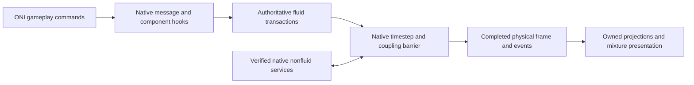

# Native simulation backend integration

Accepted architecture, 2026-10-16. Direct native integration is a core part of
the complete Mixed Atmospheres overhaul. The custom native engine must own all
fluid physics inside ONI's simulation schedule; ONI retains verified nonfluid
services. The delivery target remains the full [completion plan](completion-plan.md):
new colonies, Windows x64, native Linux x86-64, base game, Spaced Out! and all
supported gameplay packs.

**Current status:** playable native takeover is not implemented. The first
implementation is an opt-in forwarding native observer and isolated validation
harness. It does not suppress native physics or grant custom fluid authority.
Existing probes and presentation fixtures remain development tools.

## Supported build and installation

Initial profiles target ONI **744825**, Steam BuildID **24423041**, Unity
**6000.3.5f2**. Klei lists 744825 as the latest public release when checked on
2026-10-16. Future builds require inspection and new profiles.
[Klei release index](https://kleiforums.com/game-updates/oni-alpha/) and
[release notes](https://kleiforums.com/game-updates/oni-alpha/744825-r2776/).

| Platform | Native image | SHA256 |
| --- | --- | --- |
| Windows x64 | `Plugins/x86_64/SimDLL.dll` | `031960f120ac1d59fd8e43f6e1a7369111c629b90c24d52186b691dfe2d8a727` |
| Linux x86-64 | `Plugins/libSimDLL.so` | `85111cd0b1fc14c79c785581d6c055280b9d48ba705776f3d14eb0a7b239c12d` |

The mod loads its own library from `native/<platform>` and modifies verified
entry points in the loaded game module. Installed game files remain intact.
Pinned Funchook 1.1.3 and diStorm sources provide detours, with archive hashes
and license notices retained. [Upstream documentation](https://github.com/kubo/funchook).
The build applies a source-hash-checked short-JMP/Jcc relocation extension for
Linux's batch-message prologue. Internal branches, LOOP instructions and multiple
relative operands in the overwritten region reject preparation. Synthetic code
tests exercise branch outcomes, forwarding, byte restoration and rejection,
including a widened prologue that cannot fit the trampoline buffer.

Profiles bind native and Assembly-CSharp hashes. Windows locations come from
the matching shipped PDB; Linux locations come from its dynamic symbols.
Function fingerprints verify loaded code before hook installation. Each OS has
its own calling-convention and private-layout evidence: do not reuse Windows
C++ layouts on Linux. No PDB or game binary is distributed. Unknown binaries
and conflicting entry-point hooks reject activation.

The inspected Linux UnityPlayer requires glibc 2.35. Release libraries must be
built against that baseline and checked for newer symbol requirements. Current
host builds do not establish release compatibility.

## Ownership and data flow



| State or service | Required owner |
| --- | --- |
| Constituent mass, internal energy, momentum, geometry, dissolved gases | Custom native engine |
| Pipes, storage, bottles, suits, particles, machine fluid inventories | Custom transactions and persistence |
| Native scalar fluid cells and dominant element | Compatibility projection only |
| Solid-only mechanics, buildings, chunks, backwalls | Original services where independently verified |
| Fluid/nonfluid heat, displacement, melting, support, pressure damage | Explicit coupled adapter with one conserved transfer |
| Fluid disease, radiation, light absorption | Mixture-aware services; passive metadata is insufficient |
| Snapshots, rendering, sensors, navigation, callbacks | One completed-frame projection with explicit lifetimes |

Native projections may contain gas/liquid identities and bulk readings. They
must never reconstruct composition, pressure or internal energy. Route or
replace every native fluid reader/writer, including pressure/liquid flow,
thermal exchange, interactions, load-time/runtime transitions, sublimation,
emitters and consumers. Replace the containing phase/task where fluid work is
inlined. Preserve original nonfluid behavior only after proving its ownership.

Vacuum-shadow import and definition filtering remain historical controls, not
the production architecture. Their zero-native-fluid assertions do not prove
native-hook ownership. Execution traces, writer coverage and conservation must
show that only the custom engine changes authoritative fluids.

## Frames, callbacks and failures

The observed Linux path is `Sim::Main` -> `SimBase::Step`, using
`SimFrameManager::ProcessNextFrame` and `SimBase::UpdateData`. Instrumentation
must establish equivalent Windows order and exact worker completion barriers.
Exported names alone do not prove phase coverage.

Advance once per actual native timestep, normally 0.2 seconds, not once per
asteroid record or snapshot request. Preserve ordering for queued timesteps.
Tickets contain session identity and monotonic sequence; `numFramesProcessed`
is not a unique frame identity. Worker hooks never call Unity/managed gameplay.

Reserve mass, output capacity, power and heat before side effects. Publish
immutable completed snapshots and event outboxes together. Preserve native
handles, retained callbacks and exactly-once delivery. Mod-owned buffers live
until all consumers release their leases; original native pointers are not
repurposed as mixture storage.

Retry custom candidates before irreversible native work. A subsequent failure
faults the session, freezes advancement, refuses saves and requires checkpoint
reload. Do not claim native rollback without a tested restoration protocol.
Exceptions cannot unwind through callbacks. Install/remove hooks only while
simulation workers are stopped; modules and trampolines stay resident while
callers can reference them.

## Interfaces and saves

Expose a versioned `ma_oni_*` C ABI with explicit sizes and buffer ownership.
The initial implemented surface is inspection, forwarding-observer attachment,
counters and detachment. Production session initialization, commands, immutable
physical-frame leases, checkpoints and shutdown follow separate gates. There
is no independent managed advance creating a second clock.

Only new colonies opt into mixture ownership. Headless world-generation
settling and vanilla saves retain the original simulator. Stage all generated
worlds and validate compressed-liquid/EOS support before activation; do not
clamp mass, insert seed gas or sanitize through the old vacuum-shadow importer.

Save native nonfluids, physical fluids, containers, transport queues, processes,
settings and material versions at one completed frame. Manual/autosave, preview,
resume and cross-platform transfer use one atomic versioned outer container.
Test stock-loader rejection before world mutation. Missing-mod loads must never
turn scalar projections into playable mixture saves. Existing envelope/codec
helpers do not satisfy integrated persistence.

## Build and observe

The default build and probe do not enable native hooks. Build the optional
observer and standalone controls, then build the isolated licensed-game host:

```sh
python3 tools/build.py --native-only --oni-native-observer --build-dir build-oni-observer
dotnet build tools/NativeShadowProbe -c Release
python3 tools/NativeHookProbe/run.py \
  --game /path/to/OxygenNotIncluded \
  --observer build-oni-observer/libmixed_atmospheres_oni.so \
  --contract /private/game-contract-local \
  --output artifacts/native-hooks-linux
```

On Windows use an x64 Visual Studio developer environment and
`build-oni-observer/Release/mixed_atmospheres_oni.dll` for the Visual Studio
multi-configuration generator (single-configuration generators omit `Release/`).
The same Python runner supports
Windows. It compares separate unhooked/observed processes for baseline flow,
two active regions, melting, filtered transitions and native load controls.
Each process has a 45-second limit. It compares physical/event/save reports,
checks hook entry/exit balance and trace nesting, rejects live detachment and
tests undersized output buffers. The two-region fixture heats a pair of solids
in each half and requires twelve timesteps, rather than twenty-four.

To inspect or reproduce the original profiles (licensed files stay external):

```sh
python3 tools/oni_hook_profiles.py validate
python3 tools/oni_hook_profiles.py inspect \
  --windows-game /private/windows-game --linux-game /private/linux-game \
  --output /private/candidate-profiles.json
```

For actual Linux Unity observation, compile the normal ONI adapter, package
with the extra observer and use its separate forwarding test mode:

```sh
dotnet build managed/MixedAtmospheres.Oni -c Release -p:OniGameDir=/path/to/OxygenNotIncluded
python3 tools/package_probe.py --native build/libmixed_atmospheres.so \
  --native-observer build-oni-observer/libmixed_atmospheres_oni.so \
  --output artifacts/native-observer-package
python3 tools/oni_headless.py run --package artifacts/native-observer-package \
  --mode native-observer --frames 10 --timeout 600
```

For actual Windows Unity observation, build the ONI adapter against the Windows
installation and package the Windows core DLL with the observer DLL above. Then
run the disposable-colony wrapper with the explicit observer switch:

```powershell
./tools/run_colony_validation.ps1 -Package artifacts/native-observer-package `
  -Output local/colony-runs/native-observer-windows `
  -NativeObserver -Frames 10 -TimeoutSeconds 900
```

The wrapper checks the package's observer opt-in, native progress and ownership
report, and byte-identical snapshots. Other validation modes refuse packages
with native hooks. Packaging locates dependency notices and sources in exactly
one complete CMake build root, including Visual Studio's `Release/` layout.

Packaging includes the dependency licenses, modified dependency source archive
and exact patch/build instructions. It creates an explicit
`native-backend-observation.json` opt-in. The mod writes
`native-backend-observation-report.json`; the headless runner requires that
report in addition to normal startup/colony evidence. The native library stays
resident; failed-load restoration failures request process exit. `native-observer`
mode validates forwarding and byte-identical native snapshots without attempting
custom material import. The stricter `snapshot-copy` staging/roundtrip gate is
unchanged and still rejects unsupported compressed liquids.

## Current evidence and limits

Verified on 2026-10-16:

| Control | Result and limit |
| --- | --- |
| Linux Release | All nine default native CTests pass with the observer enabled, including two new ABI/relocation tests. Full managed/game-declaration regressions also pass. |
| Linux ASan/UBSan | Both new native observer/relocation tests pass. The licensed native game and dependency C sources are not sanitizer-instrumented. |
| Isolated licensed Linux | Five unhooked/observed comparisons pass, including populated/empty batches and two active regions. Physics, event and native-save reports match exactly. Twelve positive timestep returns and twelve physical updates occur per case. |
| Actual Linux Unity menu | `20261016T165746Z-b78a1c`: scoped probe and forwarding observer pass in the real Mono player. |
| Actual Linux Unity colony | `20261016T171241Z-991b86`: ten live timestep returns, ten physical updates, thirteen byte-identical snapshots, 47 channels. Original ONI owns physics. |
| Latest dependency-bound Linux Unity colony | `20261016T172520Z-92bc7f`: the trampoline-capacity repair also passes in Mono; ten additional timestep returns/physical updates, fourteen byte-identical snapshots and 47 channels, with no mod failure lines. |
| Windows MSVC Release | Actual x64 MSVC build passes strict warnings, ABI/hash/lifecycle controls and short-JMP/Jcc relocation/restoration controls. Five separate unhooked/observed licensed-native comparisons pass with identical physical/event/save reports, twelve actual timesteps/physical updates each and complete bounded control traces. |
| Actual Windows Unity colony | V60 passes in ONI 744825 / Unity 6000.3.5f2: ten additional native timestep returns and physical updates, 160 byte-identical snapshots, 47 channels, nine worlds and three duplicants. Native ONI owns physics. The colony was inspected through the Windows UI and closed normally; original mods, preferences and generated-world files were restored byte-for-byte. |
| Linux release baseline | This host's library requires glibc 2.38. A glibc-2.35 release build remains required. No release package is certified. |

Private comparison logs are under `artifacts/native-hook-observer/linux-final-v7`;
full regressions are in `artifacts/native-hook-observer/full-suite-v2.log`.
Unity evidence lives under the task-owned headless runner's `runs/<run-id>`.
Earlier failed runs remain retained: unpatched short-branch preparation;
diagnostic fixtures comparing Start with an unnormalized first query or omitting
the multi-region initial inventory; and `20261016T170003Z-5293d4`, whose native
observer/snapshot checks worked but whose legacy compressed-liquid import failed.
Those failures are not overwritten or counted as passing takeover evidence.

Windows native evidence is private under
`local/native-hook-observer-windows-r1`; its completed review SHA256 is
`3f53663f1b3fca2f9fb652b65a1a48d70f667f289eaac303cc3b182f73d4f813`.
The V60 managed build, package, bounded game capture and source closure are in
`local/native-hook-observer-windows-unity-r3`; the game evidence and Unity PNGs
are in `local/colony-runs/native-hook-observer-windows-v60`. Completed review
SHA256: `0015ff5ecee9eb4c284c520b41d3f4a6b0963046e214a4ad96433b2598fae5d1`.
These are single-agent checked records, with no independent agent review.

Retained Windows failures include an initial private launch plan pointing to a
nonexistent PowerShell executable (no game process started) and actual colony
V59. V59 reached four real native timesteps and updates before its validator
mistook ten managed acknowledgments for physical progress. Snapshot copies
matched, but the ten-step gate failed. The repaired validator waits for both
native counters without lowering the ten-step requirement; V60 passes that
gate. V59's completed failed-run review SHA256 is
`818d8cefd3388680e91a1cf1db3a5007e0432c8ce06b5d1347e11374bf79b9ac`.
No installed game binary was modified. These runs establish forwarding only;
they add no authoritative mixture rendering, takeover or performance result.

Linux's outer `Step` runs additional synchronization-only passes; its entry count
is not elapsed physical time. The isolated trace therefore distinguishes actual
positive `ProcessNextFrame` returns and `UpdateData` calls. Trace storage holds
4,096 control events and reports truncation explicitly. Full Unity traces fill
that capacity during world generation, so their prefix is not complete phase
coverage. Emitters and every inlined/virtual dispatch path still need dedicated
controls. Windows has 22 locations because `Step` has no standalone symbol;
Linux has 23. These results grant no authoritative mixture ownership.

## Implementation gates

1. **Native observer:** reproducible profiles, ABI/code verification, forwarding
   hooks, original-behavior comparisons, isolated Windows/Linux runs.
2. **Controlled takeover:** custom mixtures in a bounded Unity colony with
   progressing native solids/buildings, balanced events, multiworld scheduling,
   writer coverage and safe teardown on both platforms.
3. **Production physics:** repair strong-flow/range failures; complete vacuum,
   free surfaces, immiscible geometry, phase change, dissolved gases, compressed
   liquids and performance without relaxing scientific gates.
4. **Complete gameplay:** every inventoried producer/consumer and inventory;
   power, enthalpy, chemistry and metabolism; nitrogen starts, life support,
   research, UI and endgame progression.
5. **Persistence/release:** integrated saves, all 32 DLC configurations on both
   OSes, ten-cycle playable acceptance, 100-cycle regressions, 1,000-cycle
   all-content runs and reproducible mod-owned packages.

Retain 10,000-step mass/energy drift bounds of 1e-8/1e-6, separate trace/source
ledgers, and 25 ms per 0.1 simulated seconds for 100,000 active cells on Ryzen
5900X. Report hook/publication overhead, game p50/p95 times and peak memory.
Sustained 1x must have no growing queues or retained history. Observer success,
unit tests and presentation fixtures do not complete takeover or release.
